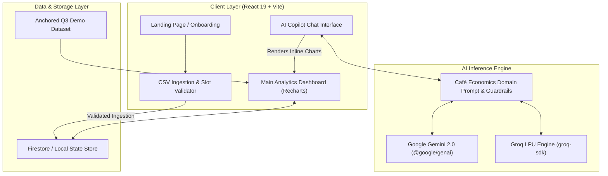

# ☕ Brewlytics — AI Financial Intelligence & Margin Copilot for Cafés

<p align="center">
  
  
  
  
  
  
  
</p>

<p align="center">
  <strong>Stop margin leaks. Forecast dead hours. Ask your café data anything in plain English.</strong><br>
  An intelligent financial copilot purpose-built for independent café owners, specialty coffee shops, and quick-service food businesses.
</p>

---

## 🎯 The Problem

Most independent café owners run on gut feeling and messy POS export spreadsheets.
- **Hidden Margin Leaks**: Dairy/oat-milk cost spikes, pastry shrinkage, and syrup wastage quietly erode 8–14% of monthly profit.
- **Spreadsheet Paralysis**: Downloading 10,000-row CSVs from POS systems (Square, Toast, Petpooja, Clover) requires hours of Excel pivot tables that never get done.
- **Staffing Misalignment**: Overstaffing during 3:00 PM dead hours and understaffing during the 8:30 AM morning rush kills customer satisfaction and burns payroll.

**Brewlytics turns messy sales and expense CSVs into instant, executive-grade business intelligence and tactical, actionable margin fixes.**

---

## ✨ Key Features

### 1. 🤖 Conversational AI Analyst Copilot
- Powered by **Google Gemini 2.0 (`@google/genai`)** and **Groq Cloud (`groq-sdk`)** for lightning-fast, ultra-low latency answers.
- Context-aware financial understanding: ask *"Why did our net margin drop last Friday?"* or *"What is our pastry-to-coffee attach rate?"*.
- **Inline Dynamic Visualizations**: The AI doesn't just reply with walls of text—it renders interactive Recharts graphs directly into the conversation stream.

### 2. ⚡ Dual Operating Modes
- **Demo Mode**: Zero-friction sandbox with pre-seeded Q3 café transaction data (18,000+ orders, realistic weekend surges, and cost shifts) pegged to an anchored timeline (`2026-09-14 18:30 IST`) so the platform never looks empty or stale.
- **Live Mode**: Clean, guided backfill workflow. Upload prior 3 months of historical data in structured monthly slots, followed by weekly/daily updates.

### 3. 📊 High-Impact Analytics Dashboard
- **Real-Time Financial KPIs**: Net Revenue, Cost of Goods Sold (COGS), Gross Margin %, Average Order Value (AOV), and Operating Expense ratio.
- **Peak-Hour Heatmaps**: Hourly sales distribution mapped against labor costs to highlight optimal barista shift allocations.
- **Menu Profitability Matrix**: Automatically classifies menu items into *Stars*, *Plowhorses*, *Puzzles*, and *Dogs* (Boston Consulting Group matrix adapted for food & beverage).

### 4. 💡 Prioritized Margin Recommendations Hub
- Algorithmic detection of food waste and pricing vulnerabilities.
- Pre-calculated tactical wins: e.g., *"Shift alt-milk surcharge by ₹20 to absorb oat milk wholesale price hike → recovers ₹14,200/month."*

### 5. 📂 Strict CSV Ingestion Pipeline
- Bulletproof client-side parsing and slot validation for:
  - **Sales**: `date, time, product, category, quantity, unit_price, revenue`
  - **Expenses**: `date, category, description, amount`
- Reject bad data upfront with human-readable error messages before it pollutes reporting.

---

## 🏗️ System Architecture



---

## 🛠️ Tech Stack

| Layer | Technology |
|---|---|
| **Frontend Framework** | [React 19](https://react.dev/) + [TypeScript](https://www.typescriptlang.org/) |
| **Bundler & Tooling** | [Vite 8](https://vitejs.dev/) + [Oxlint](https://oxc.rs/) (high-speed linter) |
| **Styling** | [Tailwind CSS 3.4](https://tailwindcss.com/) with `@tailwindcss/forms` & `@tailwindcss/container-queries` |
| **Data Visualization** | [Recharts 3](https://recharts.org/) |
| **Icons & Design** | [Lucide React](https://lucide.dev/) |
| **AI & LLM Services** | [Google Gemini 2.0 Flash](https://ai.google.dev/) (`@google/genai`) & [Groq](https://groq.com/) (`groq-sdk`) |
| **Backend & Hosting** | [Firebase Hosting](https://firebase.google.com/docs/hosting) + [Cloud Firestore](https://firebase.google.com/docs/firestore) |

---

## 🚀 Getting Started

### Prerequisites
- **Node.js**: `v18.0.0` or higher
- **npm** or **yarn**

### Installation

1. **Clone the repository:**
   ```bash
   git clone https://github.com/Aayush-Singh07/brewlytics-prototype.git
   cd brewlytics-prototype
   ```

2. **Install dependencies:**
   ```bash
   npm install
   ```

3. **Configure Environment Variables:**
   Create a `.env` file in the root directory:
   ```env
   VITE_GEMINI_API_KEY=your_google_gemini_api_key_here
   VITE_GROQ_API_KEY=your_groq_api_key_here
   VITE_FIREBASE_API_KEY=your_firebase_api_key
   VITE_FIREBASE_PROJECT_ID=your_firebase_project_id
   ```

4. **Run the local development server:**
   ```bash
   npm run dev
   ```
   Open [http://localhost:5173](http://localhost:5173) in your browser.

5. **Build for Production:**
   ```bash
   npm run build
   ```

---

## ☕ Pricing & Business Model

Designed specifically for the emerging Indian specialty coffee and QSR café ecosystem:

| Tier | Price | Features |
|---|---|---|
| **Free Starter** | ₹0 / mo | 1 Location, Demo Mode sandbox, 1 month sales CSV upload, basic dashboard |
| **Pro** | ₹999 / mo | Full historical backfill, AI Copilot analyst (50 queries/day), margin leak alerts |
| **Business** | ₹2,499 / mo | Unlimited AI analyst, multi-branch aggregation, custom menu engineering matrices |

---

## 👨‍💻 Author & Engineering Context

Built with passion by **Aayush Kumar Singh** as part of product engineering at **Fluxatic**.

- **GitHub**: [@Aayush-Singh07](https://github.com/Aayush-Singh07)
- **LinkedIn**: [Aayush Kumar Singh](https://linkedin.com/in/aayush-singh07)

---

<p align="center">
  <sub>Engineered with precision for café founders who care about every single gram of espresso and every rupee of margin.</sub>
</p>
